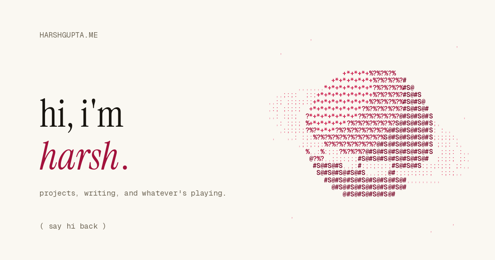

<p align="center">
  
</p>

<h1 align="center">harshgupta.me</h1>

<p align="center">
  one sentence, a planet made of characters, a guestbook, and the occasional long post.<br>
  <a href="https://harshgupta.me">harshgupta.me</a> · <a href="https://harshgupta.io">harshgupta.io</a> · <a href="https://github.com/gupta-8">@gupta-8</a>
</p>

---

## what it is

A tiny personal site that fits on one screen.

- **the sentence** — *hi, i'm harsh. i build things, i write about some of them, and usually have something on. say hi back.* The italic words are links; hover (or tap) one and a small monospace card peeks out: my top GitHub repos with a year of contribution squares, recent writing with read counts, the song that's on with a 30-second preview, and the places you can say hi.
- **the planet** — a ringed planet drawn from ~600 ascii characters on a canvas. It blooms in, scatters around your cursor, glows pink, bursts when you click (with a little sound), and reshapes itself while you hover the sentence: a spinning wireframe cube for *build things*, a blinking caret for *write*, the album cover's colours for *something*, the word "hi" for *say hi back*, a sheet of paper while you write in the guestbook. A tiny moon orbits it when nobody is touching it.
- **the guestbook** — under the planet. Open it to see who's around (approximate city only), read the last few lines people left, and leave one yourself: 140 characters, a name if you want, one line a day.
- **writing** — posts are plain markdown files in `backend/posts/`. Headings become a table of contents, code blocks get a copy button, and reads are counted.
- **small things** — lights on/off and sound on/off in the corner (remembered per device), a 404 the planet checked, share images, `prefers-reduced-motion` respected, everything lowercase.

## the stack

| | |
|---|---|
| frontend | React 19, React Router 7, Tailwind 3, `react-markdown`, a hand-written canvas particle system. No UI kit. |
| backend | FastAPI + Motor on MongoDB. Nine small endpoints, in-memory rate limits, no auth anywhere by design. |
| fonts | Instrument Serif (the sentence), Newsreader (post body), Geist Mono (cards and the planet) — self-hosted, preloaded, metric-matched fallbacks. |
| data | GitHub REST + the public contribution calendar for the *build things* card; iTunes Search for the track preview; ip-api.com for the visitor's approximate city (cached by a hashed ip, nothing more stored). |

```
backend/
  server.py          the whole api
  posts/*.md         the blog — one file per post, frontmatter on top
frontend/
  src/pages/         Home, BlogIndex, Post
  src/components/    ParticleRose (the canvas), TheSentence, PeekCards, Guestbook, CornerNotes, NotFound
  src/lib/           content.js (everything personal), sfx.js (web-audio sounds), use-stats.js (beacons + live stats)
  public/fonts/      woff2 subsets
scripts/
  planet.py          regenerates the ascii planet
  ascii.py           turns any illustration (or a flower photo) into an ascii mark instead
  og.py              paints public/og.png · favicon.py paints the favicons
```

## run it locally

You need Node 20+, Python 3.12+ and a MongoDB (local or Atlas).

```bash
# api
cd backend
cp .env.example .env            # set MONGO_URL
pip install -r requirements.txt
uvicorn server:app --reload --port 8001

# site
cd frontend
cp .env.example .env            # REACT_APP_BACKEND_URL=http://localhost:8001
yarn && yarn start
```

## deploy it

**Docker, anywhere (a VPS, Fly, Render…)** — one command brings up Mongo, the api and nginx serving the built site with `/api` proxied:

```bash
docker compose up -d --build
# → http://your-server  (set PORT=8080 etc. in the environment to change the port)
```

Put Caddy or your provider's TLS in front, point `harshgupta.me` at it, done.

**Railway** — create two services from this repo plus the MongoDB plugin:

1. *api* → root directory `backend`, it picks up the Dockerfile. Variables: `MONGO_URL` (from the plugin), `DB_NAME`, `CORS_ORIGINS=https://harshgupta.me`.
2. *web* → root directory `frontend`, build arg `REACT_APP_BACKEND_URL=https://<your-api-domain>`. Delete the `location /api/` block in `nginx.conf` since the api is served separately.

Any static host works for the frontend too (`yarn build` → `frontend/build`) as long as `REACT_APP_BACKEND_URL` points at the api.

### environment

| variable | where | what |
|---|---|---|
| `MONGO_URL`, `DB_NAME` | api | the database |
| `CORS_ORIGINS` | api | comma-separated origins allowed to call the api (`*` while developing) |
| `GITHUB_USER` | api | whose repos and contribution graph to show |
| `TRACK_QUERY` | api | search text for the "last played" card, e.g. `ribs lorde` |
| `SITE_HOST` | api | used in the ip hash salt and the user agent |
| `REACT_APP_BACKEND_URL` | site (build time) | the api's public origin; leave empty when nginx proxies `/api` |

## make it yours

- **words, links, handles, projects** — `frontend/src/lib/content.js`
- **a post** — add `backend/posts/my-post.md`:

  ```md
  ---
  title: a title, lowercase
  date: 2026-10-27
  description: one line for the list and link previews.
  ---

  markdown goes here.
  ```

- **the ascii mark** — `python scripts/planet.py` redraws the planet (tweak the constants at the top), or `python scripts/ascii.py your-image.png` to turn a tonal illustration into one. Then `python scripts/og.py` for the share image and `python scripts/favicon.py` for the icons.
- **the sounds** — `frontend/src/lib/sfx.js`, all synthesised with the Web Audio API, no files.

## privacy

No accounts, no cookies, no third-party analytics. A random id in `localStorage` tells visits apart; the api sees an ip only long enough to look up an approximate city, then keeps a salted hash of it for the one-line-a-day guestbook rule. Nothing else is stored about anyone.

## thanks

This site is a port of [rex.wf](https://rex.wf) by Mridul Balani — the design, the particle canvas, the peek cards and the guestbook idea are his, used with permission and under the MIT licence. The planet, the words and everything behind the api are mine.

## licence

MIT — see [LICENSE](LICENSE).
